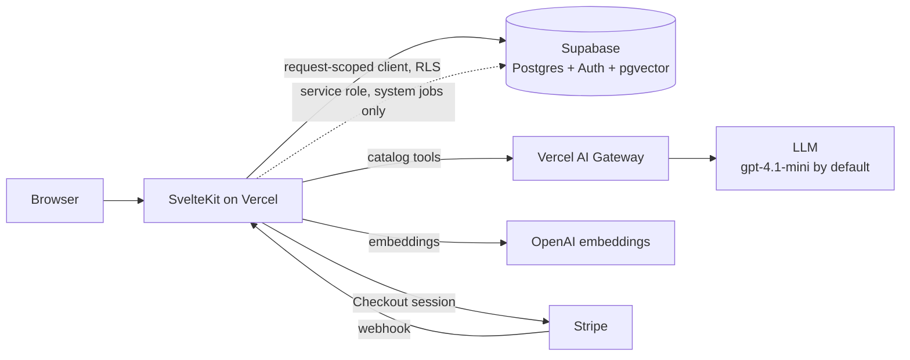

# Joule

**An AI-augmented electronics store.** Joule rebuilds a first-year ASP.NET catalog (TechnoMarket) as a modern SvelteKit + Supabase app with a grounded shopping assistant, AI review summaries, semantic search and personalised recommendations, all verified with layered BDD tests.

**Stack:** SvelteKit 2 · Svelte 5 · Supabase (Postgres, Auth, pgvector) · Stripe (test mode) · Vercel AI Gateway · Playwright-BDD · Vercel

> Built as an individual Semester 6 portfolio project at Fontys: 8 weeks, 2 sprints. Sprint 1 was test-driven with experiments as evidence; Sprint 2 added spec-first development with GitHub Spec-Kit.

---

## Contents

- [Features](#features)
- [Architecture](#architecture)
- [Getting started](#getting-started)
- [Environment variables](#environment-variables)
- [Scripts](#scripts)
- [Testing](#testing)
- [Quality & delivery](#quality--delivery)
- [Evidence & experiments](#evidence--experiments)
- [Project structure](#project-structure)
- [How the project is run](#how-the-project-is-run)
- [License](#license)

---

## Features

### Shopping
- **Catalog** — categories, product pages, filter sidebar, full-text search via a Postgres RPC, and optional semantic search with pgvector embeddings.
- **Compare** — add products to a compare tray and get a side-by-side view.
- **Cart, wishlist & checkout** — Stripe Checkout in test mode, with a webhook that marks orders paid through a dedicated SQL function, plus resume/reconcile routes for interrupted payments.
- **Accounts** — email sign-up/login through Supabase Auth.

### AI layer
- **Shopping assistant** (`/assistant`) — a tool-calling chat that can only recommend what Joule actually stocks. It searches the catalog through server-side tools and cites every product with its `[slug]`, which the tests then check against the catalog.
- **AI compare verdict** — a prose comparison of selected products. It deliberately refuses to pick a winner across different categories (ADR 0005).
- **Review intelligence** — streams a summary of a product's reviews with citations back to individual reviews.
- **Recommendations** — a hybrid recommender that combines embeddings with the user's activity (ADR 0003).
- **Guard rails** — every AI endpoint is rate-limited per IP; all model calls go through the Vercel AI Gateway (ADR 0002), defaulting to `openai/gpt-4.1-mini`.

### Admin
- **Product management** and **review moderation** (hide/unhide) at `/admin`.
- Admin pages run on the user's own request-scoped Supabase client, so Postgres row-level security decides what an admin can write. There is no service-role shortcut (ADR 0006).

---

## Architecture



A few design rules hold the codebase together:

- **RLS on day one.** Every table has row-level security before any code touches it. The service-role client is reserved for system jobs: the Stripe webhook and seed scripts.
- **Graceful degradation.** With no Supabase credentials, the app serves an in-memory seed catalog anonymously. With no OpenAI key, search falls back from semantic to text search. With no gateway key, AI scenarios are skipped in tests.
- **Grounded AI.** The model only sees catalog data through tools that never invent products; missing slugs return `null` and the assistant has to say so.

The full reasoning is in [`docs/architecture-decisions.docx`](./docs/architecture-decisions.docx) (ADR 0001–0010).

---

## Getting started

### Prerequisites
- Node.js 20+
- Docker (for local Supabase, and optionally SonarQube)
- Optional: the [Stripe CLI](https://stripe.com/docs/stripe-cli) to forward webhooks locally, and [k6](https://k6.io) for load tests

### Quick start: UI only, no backend

```bash
npm install
npm run dev            # http://localhost:5173
```

Without a `.env.local`, Joule runs in anonymous mode against the in-memory seed catalog. This is enough for UI work.

### Full setup with a local Supabase

```bash
npm install
cp .env.example .env.local          # fill in keys (see below)

npx supabase start                  # local Postgres + Auth
npm run db:migrate                  # apply supabase/migrations
npm run db:types                    # regenerate src/lib/server/db/types.ts
npm run seed                        # categories, products, images, reviews
npm run embed                       # optional: pgvector embeddings for semantic search

npm run dev
```

**Stripe webhooks locally:**

```bash
stripe listen --forward-to localhost:5173/api/stripe-webhook
```

Put the `whsec_…` secret it prints into `STRIPE_WEBHOOK_SECRET`.

**Becoming an admin:** admin rights come from `role = 'admin'` on your row in the `profiles` table. Set it in Supabase Studio after signing up.

---

## Environment variables

| Variable | Scope | Needed for |
| --- | --- | --- |
| `PUBLIC_SUPABASE_URL` | public | Database and auth |
| `PUBLIC_SUPABASE_PUBLISHABLE_KEY` | public | Database and auth (`sb_publishable_…`) |
| `SUPABASE_SECRET_KEY` | server | Seed scripts and the Stripe webhook (`sb_secret_…`) |
| `STRIPE_SECRET_KEY` | server | Checkout (test keys only) |
| `PUBLIC_STRIPE_PUBLISHABLE_KEY` | public | Checkout |
| `STRIPE_WEBHOOK_SECRET` | server | Marking orders as paid |
| `AI_GATEWAY_API_KEY` | server | Assistant, compare verdict, review intelligence, `@ai` tests |
| `JOULE_ASSISTANT_MODEL` | server | Optional; overrides `openai/gpt-4.1-mini` |
| `OPENAI_API_KEY` | server | Embeddings and semantic search (`text-embedding-3-small`) |

Every group is optional. Leaving one out switches off its feature instead of crashing the app.

---

## Scripts

| Command | Purpose |
| --- | --- |
| `npm run dev` | Vite dev server |
| `npm run build` / `npm run preview` | Production build and local preview |
| `npm run check` | `svelte-check` typecheck |
| `npm run lint` / `npm run format` | Prettier + ESLint / Prettier write |
| `npm run test:unit` | Vitest unit tests |
| `npm run test:coverage` | Vitest with V8 coverage |
| `npm run test:e2e` | Playwright end-to-end |
| `npm run test:bdd` | Playwright-BDD scenarios |
| `npm run db:migrate` / `db:reset` / `db:types` | Supabase migrations, reset, type generation |
| `npm run seed` / `npm run embed` | Seed the catalog / generate embeddings |
| `npm run experiment:a` / `experiment:b` | Re-run the AI experiments (see below) |
| `npm run dora:report` | Regenerate `docs/dora.md` |
| `npm run sonar:up` / `sonar:setup` / `sonar:scan` / `sonar:down` | Local SonarQube lifecycle |
| `npm run docs:build` | Build the portfolio `.docx` documents |

---

## Testing

Joule's test strategy is built around one problem: **how do you test features driven by a non-deterministic model?** The answer is a layered BDD suite on top of unit tests.

| Layer | Tag | What it asserts | When it runs |
| --- | --- | --- | --- |
| **Unit** | — | Catalog queries, cart, auth, admin logic, rate limiting, prompt building, tools (`tests/unit`) | Always |
| **Layer 1** | — | Deterministic UI scenarios: browsing, reviews, compare, admin access. A flake here is a bug. | Always, including CI |
| **Layer 2** | `@ai` | Structural invariants against the live model, e.g. every cited slug exists in the catalog and every review citation is in range | Only when `AI_GATEWAY_API_KEY` is set |
| **Layer 3** | `@ai @l3` | Tolerance: each scenario runs N times and passes if at least M succeed (default 8 of 10) | Only when `AI_GATEWAY_API_KEY` is set |

Feature files are in `tests/bdd/features`, step definitions in `tests/bdd/steps`. BDD runs against a production build served on port 4173.

**Load tests** (`tests/load`, k6): `smoke`, `sustained`, `journey`, `spike` and `stress`. See [`docs/load-test.md`](./docs/load-test.md).

```bash
k6 run -e BASE_URL=http://localhost:4173 tests/load/sustained.js
```

---

## Quality & delivery

| Workflow | Trigger | What it does |
| --- | --- | --- |
| **CI** | Push to `main` / `week-*`, PRs to `main` | Typecheck, lint, unit tests, then BDD Layer 1 with report upload |
| **SonarQube** | Push to `main` | Coverage plus a self-hosted SonarQube scan with a gate-as-code quality gate ([`docs/sonar.md`](./docs/sonar.md)) |
| **Post-deploy smoke** | Push to `main` | Waits for the Vercel deploy, then runs the k6 smoke test against production |
| **DORA report** | Weekly (Sunday 06:00 UTC) | Recomputes the four DORA metrics from merged PRs into [`docs/dora.md`](./docs/dora.md) |

Deployment is Vercel's Git integration: every merge to `main` deploys to production. Vercel Analytics and Speed Insights cover real-user monitoring (ADR 0007).

---

## Evidence & experiments

Claims in this project are backed by measurements, and the results are kept even when they didn't go the expected way.

- **[Experiment A: grounded vs ungrounded answers](./docs/experiment-a.md).** 24 shopping prompts were run with and without the catalog tools. The grounded assistant made 51 product citations with **0 hallucinated slugs**. Without grounding, **95% of the products the model named were not sold by Joule.**
- **[Experiment B: visible vs hidden reasoning](./docs/experiment-b.md).** An LLM judge compared answers with and without `[slug]` citation chips. Plain prose was preferred 7 out of 10 times, mostly on clarity, while trust scores were equal.
- **[Load and performance](./docs/load-test-results.md).** The baseline was already fast (catalog p95 327 ms, Lighthouse 99). The edge-cache and personalisation work then caused a measurable regression: Lighthouse dropped to a median of 86 over 5 runs. **That change was reverted** (ADR 0010), the `<Image>` component was kept for its layout-shift protection, and the evidence stays in the repo.

The Lighthouse reports, raw k6 output, weekly reports and the sprint retro are all in [`docs/`](./docs).

---

## Project structure

```
src/
├── routes/
│   ├── (shop)/            # catalog, product, search, compare, cart, checkout, account, assistant
│   ├── (auth)/            # login, signup, logout, OAuth callback
│   ├── admin/             # product management, review moderation
│   └── api/               # assistant, compare, review-intelligence, stripe-webhook
├── lib/
│   ├── catalog/           # queries + in-memory seed fallback
│   ├── components/        # UI (product, catalog, compare, site, Image)
│   └── server/            # auth, cart, wishlist, reviews, recommendations,
│       ├── ai/            #   gateway, prompts, tools, assistant, compare, review intelligence
│       └── admin/         #   admin data access
supabase/migrations/       # schema, search RPC, RLS policies
tests/
├── unit/                  # Vitest
├── bdd/                   # Playwright-BDD features + steps
└── load/                  # k6 scripts
specs/                     # Spec-Kit feature specs (001–004)
scripts/                   # seed, embeddings, experiments, DORA, docs build
docs/                      # ADRs, experiments, load tests, weekly reports
```

---

## How the project is run

- **One branch per week.** Each week has its own integration branch (`week-NN-<theme>`) and lands on `main` through a single squash PR tagged `week-NN-done`.
- **Spec before code (Sprint 2).** Features that touch more than one file get a `spec.md`, `plan.md` and `tasks.md` under [`specs/`](./specs) using [GitHub Spec-Kit](https://github.com/github/spec-kit) before any implementation.
- **Constitution.** Five non-negotiable principles (RLS on day one, spec before code, a test pyramid with real coverage gates, tracked decisions and evidence, one branch per week) are in [`.specify/memory/constitution.md`](./.specify/memory/constitution.md).

---

## License

[MIT](./LICENSE) © 2026 Aleksandar Lalov
